<p align="center">
  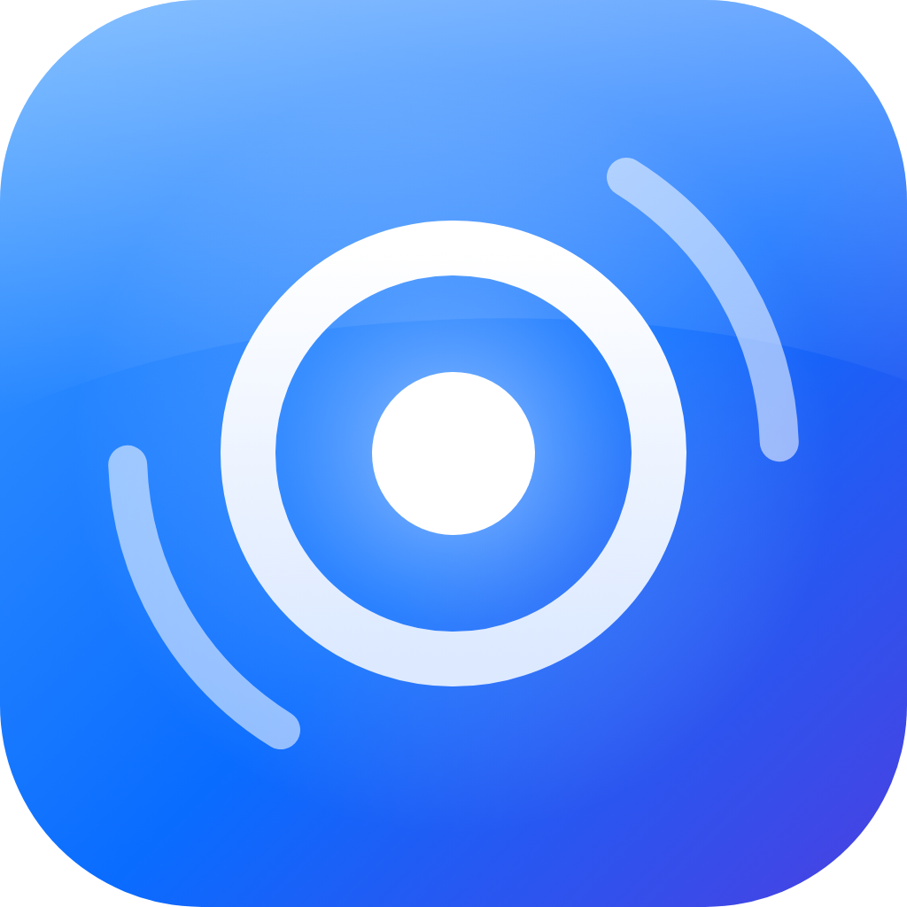
</p>

<h1 align="center">Halo</h1>

<p align="center"><b>把 NAS 變成一支電話。</b><br>插上 4G 模組或 SIM 讀卡器，用瀏覽器、iPhone 或 SIP 軟電話，在任何地方打電話、收簡訊。</p>

<p align="center">
  <a href="docs/GUIDE.zh-TW.md">使用教程</a> ·
  <a href="docs/RELEASE_NOTES.zh-TW.md">1.2.0 版本說明</a> ·
  <a href="#尚未完成">尚未完成的功能</a> ·
  <a href="#致謝">致謝</a>
</p>

## Halo 是什麼

Halo 是 [Nan7Li](https://github.com/Nan7Li) 開發的「遠端手機」系統，跑在家裡的 NAS 上。SIM 卡和行動網路留在家裡，通話與簡訊透過網頁、iPhone 或 SIP 軟電話帶到你身邊。

Halo 把幾件原本分散的事做成一個產品：

- **電話**：iOS 風格的撥號鍵盤、最近通話、通話錄音，瀏覽器直接接聽與通話。音訊路徑是 Halo 自己寫的：AudioWorklet、抖動緩衝、帶限重取樣、定速的 ALSA 上行。
- **一個介面管所有線路**：模組的 VoWiFi（IMS）、大疆 QDC507 模組的蜂窩語音、SIM 讀卡器的 IMS 線路、裝了 AirSIM 的安卓手機，全部在同一個電話頁裡選擇。
- **iPhone 聽筒**：Halo 依 AirSIM 的協定自行實作了安卓端，iPhone 上的 AirSIM App 可以直接用 Halo 的號碼打電話、收簡訊。
- **VPS 中繼**：內建 WireGuard 中繼。一鍵產生 VPS 安裝腳本與裝置設定，家裡沒有公網 IP 也能從外面連回 Halo，也能當成小火箭的節點用。
- **SIP 閘道與 QDC507 語音**：整合 CellBridge，任何 SIP 軟電話都能撥入 Halo；QDC507 的聲卡初始化、語音模組載入與校驗由 Halo 自動處理。
- **NAS 一鍵安裝與自動更新**：Debian 13 一行指令裝好，可選正式或預覽安裝包；NAS 使用 CellBridge 更新通道，在沒有通話時自動更新，帳號與資料保留。
- **全新介面**：依 Apple HIG 設計的 iOS 27 / macOS Liquid Glass 介面，手機、平板、電腦都能用，透明度、強調色、動畫都可以調。

底層的模組控制、IMS / Wi‑Fi Calling、簡訊、eSIM 和代理使用 [VoCat](https://github.com/MengMengCode/VoCat)，詳見[架構](#架構)。

## 架構

```
┌──────────────────────────── Halo ────────────────────────────┐
│  介面（Liquid Glass）· 電話 / 最近通話 / 錄音 · 外觀設定       │
│  瀏覽器通話音訊 · iPhone 聽筒（AirSIM 協定）· 安卓手機線路      │
│  VPS 中繼（WireGuard）· NAS 安裝器 · stable / CellBridge 更新通道        │
│  CellBridge 整合：SIP 閘道 · QDC507 蜂窩語音                   │
├──────────────────────────────────────────────────────────────┤
│  VoCat 核心：模組控制 · IMS / Wi‑Fi Calling · 簡訊 · eSIM · 代理 │
└──────────────────────────────────────────────────────────────┘
```

## 介面

<p align="center">
  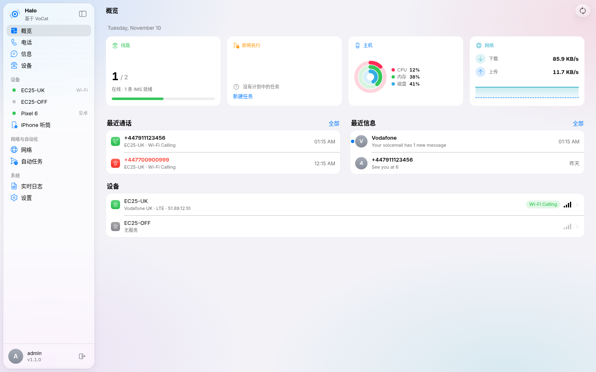
  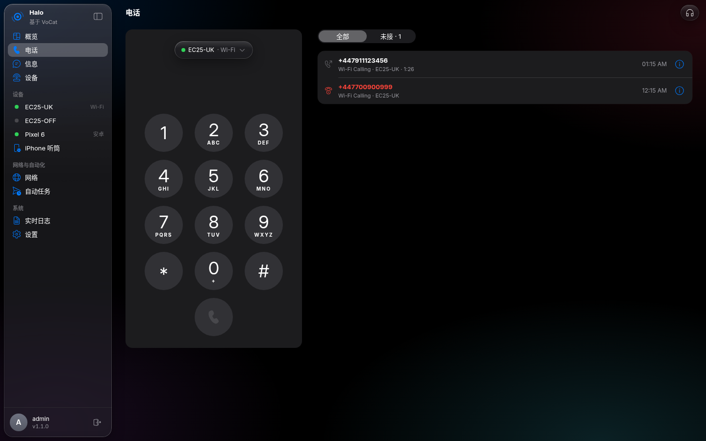
  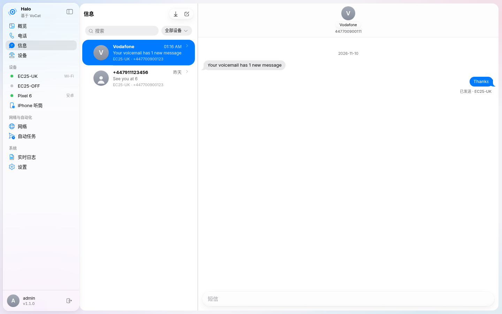
  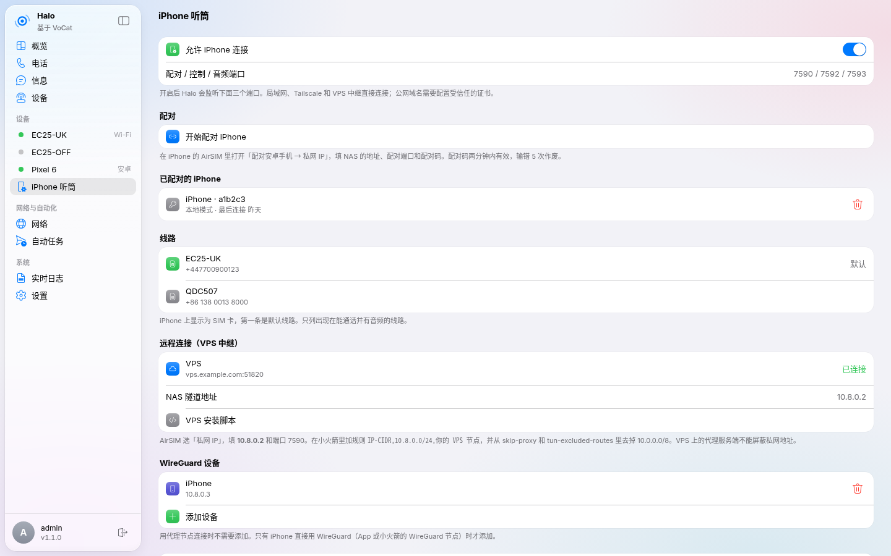
</p>

<p align="center">
  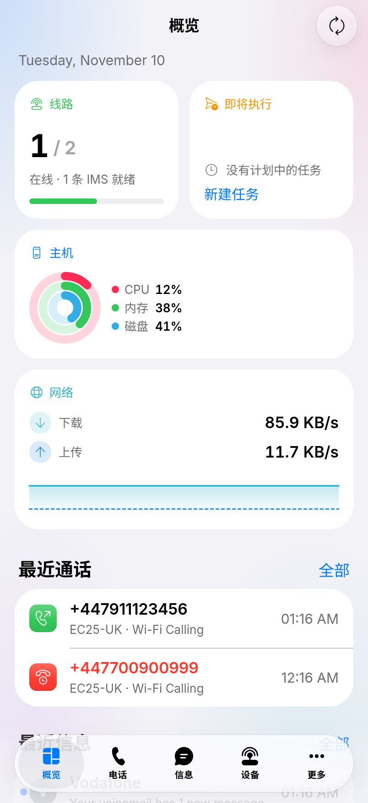
  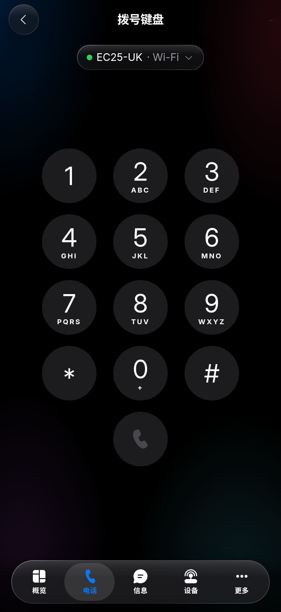
  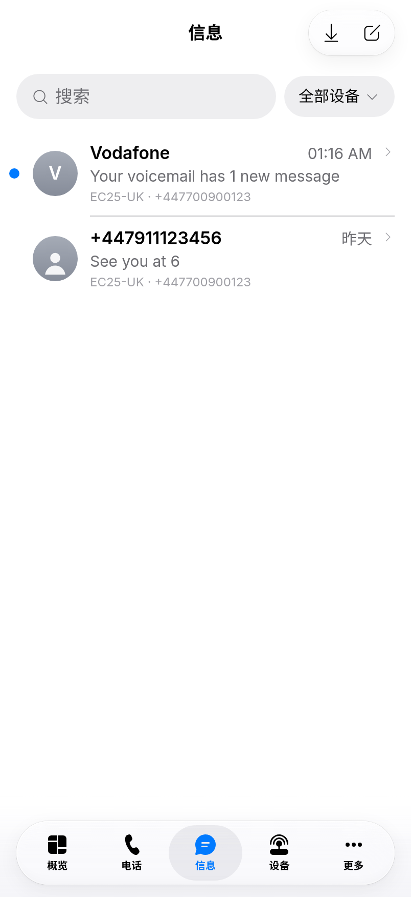
  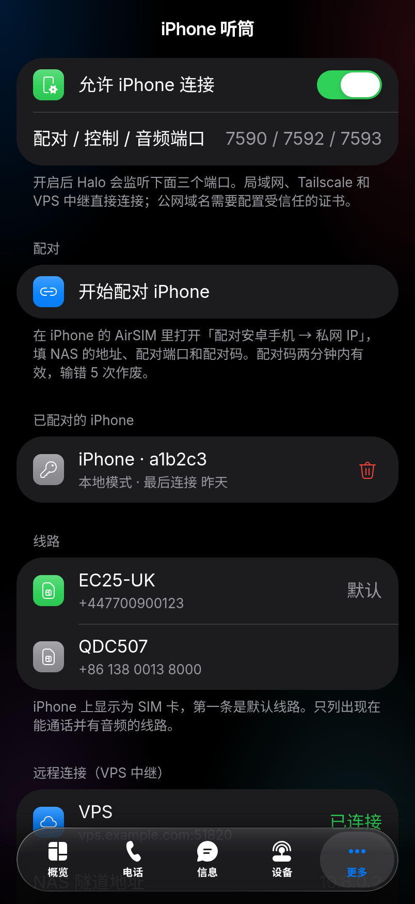
</p>

<p align="center">
  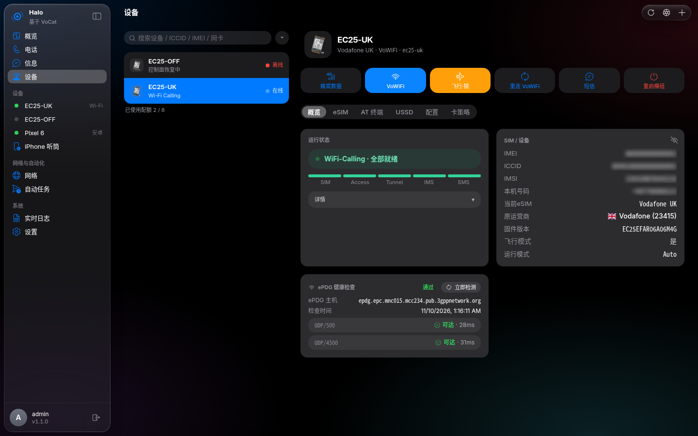
  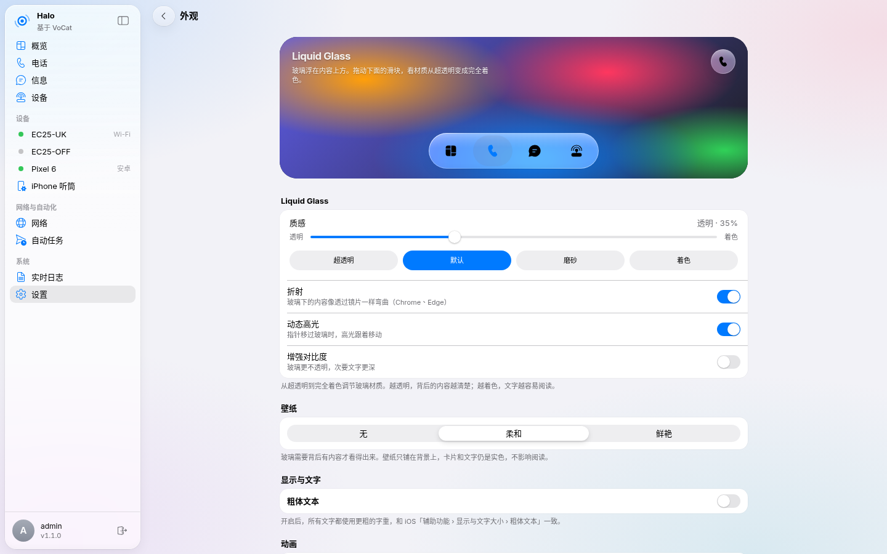
</p>

截圖使用預覽環境的示範資料，號碼都是假的。

## 快速開始

Debian 13 / amd64 的 NAS（J3160、N5105 等）：

```bash
sudo bash -o pipefail -c 'apt-get update && apt-get install -y curl ca-certificates && curl -fsSL https://raw.githubusercontent.com/Nan7Li/Halo/halo/scripts/deploy-cellbridge-nas.sh | bash'
```

裝好後打開 `http://NAS的IP:7575`。安裝程式預設裝最新的正式版。想試最新的預覽版：

```bash
sudo bash -o pipefail -c 'apt-get update && apt-get install -y curl ca-certificates && curl -fsSL https://raw.githubusercontent.com/Nan7Li/Halo/halo/scripts/deploy-cellbridge-nas.sh | bash -s -- --preview'
```

接下來怎麼接模組、打第一通電話、讓 iPhone 從外面連回來，請看 **[使用教程](docs/GUIDE.zh-TW.md)**。

## 功能狀態

| 功能 | 狀態 |
| --- | --- |
| 模組管理、AT / USSD、簡訊、eSIM、代理、通知（來自 VoCat） | 可用 |
| VoWiFi（IMS）通話、瀏覽器通話、錄音 | 可用，依電信商而定 |
| 網頁介面、外觀設定、大頭照 | 可用 |
| NAS 安裝、自動更新 | 可用 |
| WireGuard 隧道、匯出代理 | 可用 |
| 大疆 QDC507 蜂窩語音（CellBridge） | **未在實機驗證** |
| SIP 閘道 | **未在實機驗證** |
| iPhone 聽筒（AirSIM iOS） | **未在實機完整驗證** |
| 安卓手機線路（AirSIM Android） | **未在實機驗證** |
| VPS 中繼 | **未在真實 VPS 驗證** |

## 尚未完成

這些功能程式碼已經在 1.2.0 裡，但還沒有完成或沒有在真實硬體上驗證過。使用時請預期會遇到問題，並歡迎回報。

1. **大疆 QDC507 蜂窩語音**：只用模擬裝置和單元測試驗證過，還沒有在真實模組上完成雙向通話。剛開機的模組要先載入語音模組才會出現聲卡（[#16](https://github.com/Nan7Li/Halo/pull/16) 已修正初始化順序，仍待實機驗證）。廠商語音運行檔不在本倉庫，由安裝程式從 MaVo 下載並校驗。
2. **SIP 閘道**：只支援 UDP（信令與 RTP），沒有 TCP / TLS；iPhone 鎖屏來電取決於你用的 SIP App。
3. **iPhone 聽筒（AirSIM iOS）**：
   - 不支援 DTMF（通話中按鍵）和早期媒體（接通前的回鈴音 / 語音提示）。
   - 雲端模式一次只服務一台用雲端模式配對的 iPhone；簡訊沒有端到端加密封裝。
   - 雲端模式和背景來電要經過 AirSIM 作者的 Relay 伺服器，還沒在真實 Relay 上驗證。
   - 本地 / VPS 模式下，AirSIM 要在前景才收得到來電。
4. **安卓手機線路**：還沒在真實安卓手機上驗證；用本地模式配對會覆蓋那支手機原本的 AirSIM 雲端設定。
5. **VPS 中繼**：還沒在真實 VPS 上驗證；跨境使用時 WireGuard 可能被限速或阻斷，需要自己加混淆或改走代理節點。
6. **瀏覽器通話音訊**：只在 Chromium 做過自動化驗證；Safari / iOS 瀏覽器需要實測。麥克風必須在 HTTPS 下才能用，否則只能聽。
7. **eSIM**：部分後端只支援列出和切換 Profile，不支援下載、刪除、改名（沿用 VoCat 的限制）。
8. **其他平台**：Windows 原生 WWAN（[#2](https://github.com/Nan7Li/Halo/pull/2)）和桌面用戶端（halo-windows）仍是草稿；NAS 安裝包只提供 Debian 13 / amd64。
9. **VoWiFi 電信商相容性**：額外的 IKE DH 群組相容分支還沒合併，部分電信商可能連不上 ePDG。

## 致謝

Halo 是站在很多人的肩膀上做出來的。謝謝這些專案的作者把成果公開出來：

- **[VoCat](https://github.com/MengMengCode/VoCat)**（MengMengCode 與 Vocat Project Authors）：Halo 的地基。模組控制、IMS / Wi‑Fi Calling、簡訊、eSIM、代理、通知都是他們的工作。
- **[CellBridge](https://github.com/mccding/CellBridge)**（mccding 與 CellBridge contributors，MIT）：SIP 閘道和大疆 QDC507 蜂窩語音橋。
- **[AirSIM](https://github.com/kai-wu-cortex/AirSIM)**（kai-wu-cortex 與 AirSIM contributors，PolyForm Noncommercial）：iPhone 聽筒和安卓手機線路所用的配對與 VoWLAN 協定。Halo 依協定自行實作，沒有複製 AirSIM 的程式碼。
- **[MaVo](https://github.com/moluncn/mavo)**（moluncn）：QDC507 模組端的語音運行檔（ModuleVoice）。
- **[quectel-qmi-go](https://github.com/iniwex5/quectel-qmi-go)**（iniwex5，MIT）：原生高通 QMI 支援。
- 以及 [WireGuard](https://www.wireguard.com/)、[Go](https://go.dev/)、[React](https://react.dev/)、[Vite](https://vite.dev/)、[Tailwind CSS](https://tailwindcss.com/)、[Fluent UI Icons](https://github.com/microsoft/fluentui-system-icons)、[Apache ECharts](https://echarts.apache.org/)、[modernc SQLite](https://gitlab.com/cznic/sqlite)、[warthog618/sms](https://github.com/warthog618/sms)、[go.bug.st/serial](https://github.com/bugst/go-serial)、[coder/websocket](https://github.com/coder/websocket)、[howett.net/plist](https://github.com/DHowett/go-plist) 等開源專案。

完整的出處、授權與修改說明見 [ATTRIBUTION.md](ATTRIBUTION.md) 和 [NOTICE](NOTICE)。

## 授權與出處

> **Halo 1.2.0** is developed by Nan7Li and built on [VoCat](https://github.com/MengMengCode/VoCat) v0.3.42 by the Vocat Project Authors, which provides the modem, IMS / WiFi Calling, SMS, eSIM, and proxy core. Halo's phone, call audio, CellBridge and AirSIM integration, VPS relay, installer, and interface are its own work. The [Vocat Research & Evaluation License](LICENSE) applies. See [ATTRIBUTION.md](ATTRIBUTION.md).

Halo 的核心建立在 VoCat 之上，因此整體適用 [Vocat Research & Evaluation License](LICENSE)：僅限非商業的研究、教育與個人硬體開發，並有地區、評估期與 SIM 卡使用上的限制，請在使用前完整閱讀。CellBridge 的部分另依 MIT，AirSIM 協定部分另依 PolyForm Noncommercial 1.0.0，見 [LICENSES/](LICENSES/)。Halo 對 VoCat 做了哪些修改，記錄在 [ATTRIBUTION.md](ATTRIBUTION.md)；VoCat 原專案的說明在 [docs/README.vocat.en.md](docs/README.vocat.en.md)。

Halo 不是 VoCat、CellBridge 或 AirSIM 的官方產品，也沒有得到它們的背書；各專案的名稱與標誌屬於原作者。
